<div align="center">
  
  <h1>Momus Studio</h1>
  <p><b>Windows için yeni nesil Apple Dynamic Island (Dinamik Ada) ve Çok Amaçlı Masaüstü Asistanı</b></p>

  <p>
    
    
    
    
  </p>
</div>

---

##  Öne Çıkan Özellikler (v1.1.0)

-  **Apple Dynamic Island Deneyimi:** Ekranın üst kenarında akıcı animasyonlarla çalışan kompakt hap (Pill) ve genişletilmiş çentik (Expanded Notch) modları.
-  **Spotify & YouTube Canlı Medya:**
  - Anlık şarkı adı, sanatçı ve albüm kapağı senkronizasyonu.
  - Canlı parça ilerleme çubuğu ve müzik kontrolleri (Önceki / Duraklat / Sonraki).
  - YouTube sekmesine geçildiğinde dinamik kırmızı durum feneri.
-  **Dinamik Ada Temaları & Ambient Glow:** Çalan şarkının albüm kapağından baskın rengi çıkararak monitörün üst çerçevesine yayılan şık ortam aydınlatması (Ambient Backlight).
-  **Akıllı Oyun Modu (Auto-Hide):** Tam ekran bir oyun açıldığında yerel C# dedektörüyle (`FullscreenDetector.exe`) adayı otomatik gizler, masaüstüne dönüldüğünde geri getirir.
-  **Mikrofon & Kamera Gizlilik Kalkanı:** Arka planda mikrofon veya kamera kullanıldığında çentikte beliren canlı yeşil ve turuncu gizlilik noktaları.
-  **Sürükle-Bırak Hızlı Format Dönüştürücü:** Görselleri çentiğe bırakıp tek tıkla `PNG`, `JPG` veya `ICO` formatlarına dönüştürme yuvası.
-  **Spotlight Hızlı Arama & Hesap Makinesi:** `Alt+Space` ile anında açılan, matematiksel formülleri canlı hesaplayan ve Google araması yapan Spotlight çubuğu.
-  **AirDrop Rafı & Hızlı Not:** Dosyaları geçici olarak tutabileceğiniz masaüstü rafı ve otomatik kaydedilen minimalist not defteri.

---

##  Klavye Kısayolları

| Kısayol | İşlev |
| :--- | :--- |
| `Ctrl + Shift + M` | Çentiği Gizle / Göster (Stealth Modu) |
| `Alt + Space` | Spotlight Arama & Hesap Makinesini Aç / Kapat |
| `Alt + M` | Kompakt Pili Genişletilmiş Çentiğe Dönüştür |
| `Esc` | Genişletilmiş Görünümden Kompakt Pile Dön / Kapat |

---

##  İndirme & Kurulum

En son derlenmiş Windows kurulum paketini [Releases](https://github.com/Seyoria/Momus-Studio/releases) sayfasından indirebilirsiniz:

-  **[Momus Studio Setup 1.1.0.exe](https://github.com/Seyoria/Momus-Studio/releases/download/v1.1.0/Momus.Studio.Setup.1.1.0.exe)**

---

##  Geliştirici Kurulumu

Projeyi yerel ortamda çalıştırmak veya kaynak koddan derlemek için:

```bash
# 1. Depoyu klonlayın
git clone https://github.com/Seyoria/Momus-Studio.git
cd Momus-Studio

# 2. Bağımlılıkları yükleyin
npm install

# 3. Geliştirici modunda başlatın
npm run dev

# 4. Windows Kurulum Paketi (.exe) üretin
npm run dist
```

---

##  Lisans

Bu proje [MIT Lisansı](LICENSE) altında korunmaktadır. © 2026 Momus Studio / Seyoria
